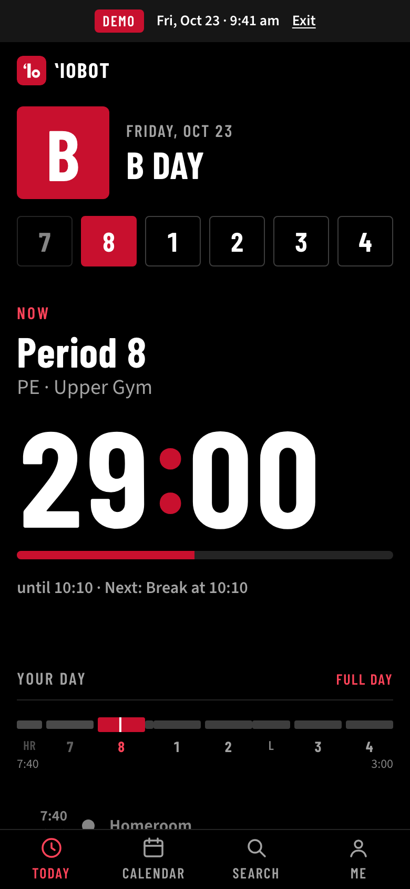
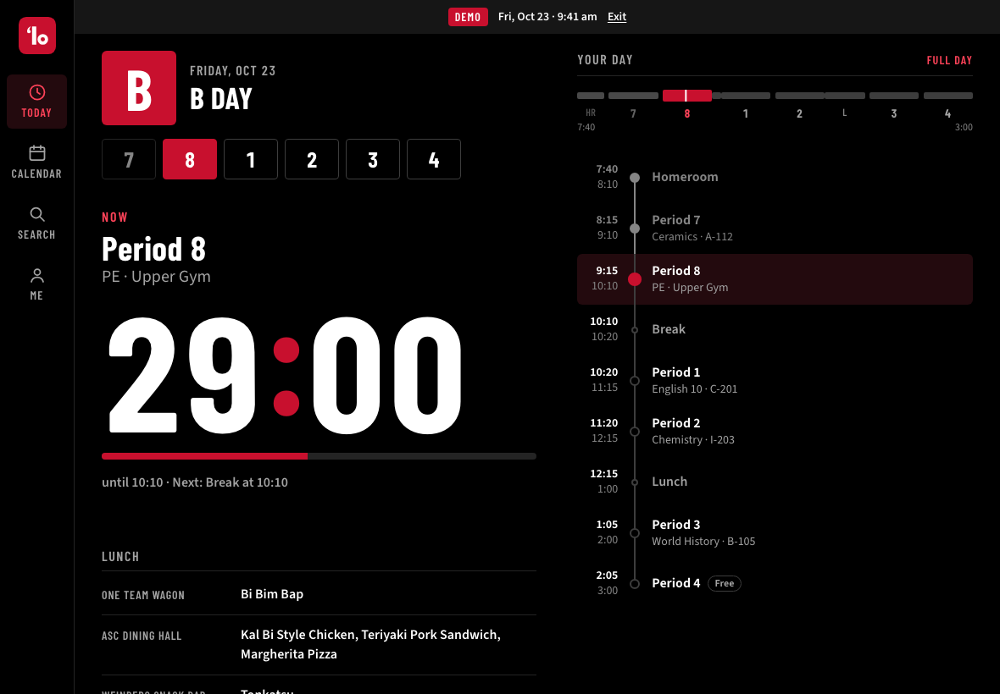
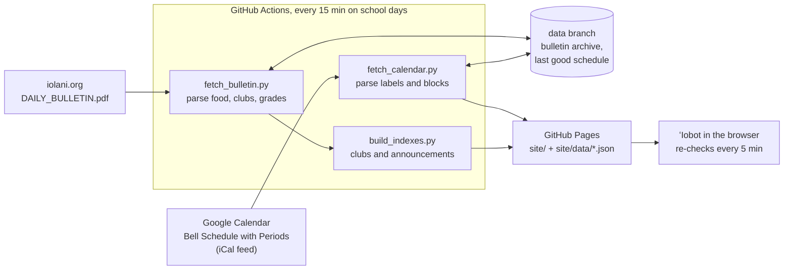

# ʻIobot

The bell schedule for ʻIolani School's Upper School: what period it is, how
long is left (to the second), today's lunch, and the daily bulletin, built for
a student checking an iPad between classes.

ʻIobot v2 replaces the original ʻIobot Google Sites widget. It reads the
school's own "Bell Schedule with Periods" calendar feed and the daily
bulletin PDF, so it follows schedule changes, assembly days and holidays
without anyone updating it by hand.

| Phone | iPad, landscape |
|---|---|
|  |  |

More screenshots, every screen at four sizes in both themes, are in
[`docs/screenshots/`](docs/screenshots/).

## What it does

- **Now.** The current block (with your class name and room), a countdown that
  rolls each second over, and a progress bar. Before school, passing time,
  lunch, after school and days off each get their own wording.
- **Today.** The day letter, the period order as scoreboard boxes with the
  current period in red, chapel for your grade, a bar showing the whole day to
  scale, every block on a transit-style timeline, lunch from the bulletin, and
  announcements for your grade and the clubs you follow.
- **Calendar.** A month of school days with their letters, special schedules
  marked, days off grayed, and your chapel days dotted. Any day opens in full.
- **Search.** One box for dates (`next F day`, `nov 3`, `days until christmas break`),
  clubs (typos forgiven: `mahjog` finds Mahjong Club), and every bulletin
  saved so far (`yearbook photo`, `pā`).
- **Me.** Your grade, class names and rooms, followed clubs, Black (the
  default) or White, reduced motion, and a code to copy your setup to another device.
- **Works offline** and installs to the iPad home screen.
- **Demo mode** for presentations: `?date=2026-10-21&time=09:00` makes the
  app act as if it's that moment, and `&speed=60` runs the clock 60× faster.

## How the live data works

Browsers can't download Google Calendar feeds or iolani.org's PDF directly:
those servers don't allow other websites to read them (no CORS headers). So a
small Python program does the fetching on GitHub's servers, every 15 minutes
during the school day, and saves the results as JSON files next to the site.
The site itself is plain HTML, CSS and JavaScript that reads those files.



### The calendar feed, step by step

`pipeline/fetch_calendar.py` and `pipeline/calendar_parse.py`:

1. **Download** the feed URL from `config.json` (or a repository secret) with a
   20-second timeout and a cache-busting `?t=` query.
2. **Read every event** with the `icalendar` library, which handles Google's
   folded lines and escaped commas (`(3\,4\,1\,2)`).
3. **Keep only this school year**: everything from July 1 of the year that
   contains today. That's about 200 dates out of the feed's 21,000 events
   since 2014. Repeating (`RRULE`) events only exist before 2017 and are never
   expanded, so they can't leak into this year.
4. **Sort events into two kinds.** All-day events are day labels
   (`E Schedule (3,4,1,2) (Grs. 9&10 Chapel)`, `FALL BREAK`). Timed events are
   blocks (`Period 3`, `Lunch`, `Homeroom/Chapel`), stored in UTC and converted
   to Honolulu time.
5. **Normalize names.** Whitespace is collapsed (`'B Schedule '` has a trailing
   space), and block names map to one display name and a kind:
   `Chapel/ Assembly` → Chapel/Assembly, `Per 3 B` → Period 3, `HR` → Homeroom.
6. **Read each label**: the letter and variant (`E`, `E1`, `F3`), the period
   order in parentheses (with a stray trailing comma allowed), and which grades
   have chapel.
7. **Check the blocks against the label.** If a plain C day is missing Period 5
   (it happens: Sept 16), that period is recorded as dropped, and the day is
   marked special so it gets a red corner on the calendar.
8. **Write `site/data/schedule.json`.** If the download or parse fails, the last
   good schedule (kept on the data branch) is published again, so the site never goes blank.

`python -m pipeline.report` prints every distinct label and block name in the
feed. The normalization rules above were written from that list.

### Special days and grades

- **Day types.** A label with "Schedule" in it is a class day. `US FINAL EXAMS`
  is an exam day. Everything else (`FALL BREAK`, `… SCHOOL HOLIDAY`,
  `NO US CLASSES`) is a day off, with a readable name ("Indigenous Peoples' Day").
  Weekends aren't in the feed and are filled in by the site.
- **Several labels on one day** (exam week has `US FINAL EXAMS` and
  `NO US CLASSES`) are all kept; the most useful one is shown.
- **Special schedules** (E1–F3 assembly days, `Chapel (No Chapel) Schedule`,
  `PSAT Schedule Day`, the Christmas and Easter chapel days) show their own
  blocks from the feed. Nothing is hardcoded, so a schedule the school invents
  next year works the same way. PSAT day has no timed blocks in the feed, and
  the site says so instead of guessing.
- **Grades only appear in the chapel note**, so `grades.py` turns every
  format into a set of grades: `(Grs. 9&10 Chapel)` → {9, 10},
  `(Gr. 7 Chapel/Gr. 8 remain in HR)` → {7}, `(NO CHAPEL)` → none.
  The first block of the day is then called **Chapel** for those grades and
  **Homeroom** for everyone else.

### The daily bulletin, every 15 minutes

`pipeline/fetch_bulletin.py`, `bulletin_parse.py` and `clubs.py`:

1. **Download** `DAILY_BULLETIN.pdf` with a `?t=<unix time>` query and a
   `Cache-Control: no-cache` header. The school overwrites the same address
   every day and sometimes corrects it later the same day.
2. **Hash the bytes.** If they match the last run, stop: nothing new.
3. **Extract the text** with `pdfplumber`. The real PDF is one column. Section
   headings sometimes share a line with their first entry (`EVERYONE:--ALOHA FRIDAY…`),
   and older layouts put two header fields on one line. Both are handled.
4. **Parse:** the lunch lines (`One Team Wagon:`, `ASC Dining Hall:`,
   `Weinberg Snack Bar:`, including ones that wrap), the `US SCHEDULE` letter
   and period order, every TODAY'S SCHEDULE line (start, end, title, location,
   grades from `Srs.`/`Jrs.`/`Sophs.`/`Frosh`), and every ALL-CAPS section with
   its grade heading (`GRS 9-11:` → {9, 10, 11}).
5. **Find clubs** in ORGANIZATIONS and in TODAY'S SCHEDULE (`Karaoke Club Mtg`),
   with grade tags, dates ("Mon, Oct 26", "today", "10/27"), times
   ("12:20pm", "lunch") and rooms (`I-203`, `ASC303`, `the Pā`). "CHESS CLUB" and
   "Chess Club Mtg" become one club.
6. **Archive it** as `archive/bulletins/YYYY-MM-DD.json` on the data branch. A
   correction later that day replaces that day's file. The school doesn't keep
   old bulletins, so over the year this becomes a searchable record.
7. **Publish `today.json` only if the bulletin's own date line is today** in
   Honolulu. Until today's is posted, the site says so instead of showing
   yesterday's lunch.
8. **Compare** its `US SCHEDULE` line with the calendar. If they disagree, the
   calendar wins (as the contest requires), the run logs a warning, and Today
   shows a one-line notice.

`build_indexes.py` then writes `clubs.json`, one page per club, and
`announcements.json` for search and the grade pages.

### In the browser

- The site re-downloads its data every 5 minutes and whenever you come back to
  the tab. If something changed, the screen updates in place with a short fade.
- The countdown never subtracts a second. Each animation frame it computes
  `end − now` from the real clock (in Honolulu time, whatever the device's time
  zone is), so it can't drift, and it re-syncs after the iPad sleeps.
- A service worker keeps a copy of the app and the last data. Offline, the
  countdown keeps running from the saved schedule and a small "Offline" tag appears.

## Running it locally

You need Python 3.11 or newer.

```bash
python3 -m venv .venv
```

```bash
.venv/bin/pip install -r requirements-dev.txt
```

```bash
.venv/bin/python -m pipeline.run --offline
```

```bash
python3 -m http.server 8000 -d site
```

Then open <http://localhost:8000>. `--offline` builds the data from the files in
`fixtures/`. Without it, the pipeline downloads today's real bulletin (and the
real feed, once its URL is in `config.json`).

To see a specific moment, add demo settings to the address:
<http://localhost:8000/?date=2026-10-20&time=09:24:50#/today> (watch Period 3
end), or `&speed=60` to run a whole period in about a minute.

## Tests

```bash
.venv/bin/python -m playwright install chromium
```

```bash
.venv/bin/python -m pytest
```

- `test_calendar.py`, `test_grades.py`: every calendar case in the brief (the
  Oct 20 E day, the Oct 21 F day, PSAT day, Fall Break, A–D, E1/F1, one-grade
  chapel, NO CHAPEL, `Gr. 7 Chapel/Gr. 8 remain in HR`, exam week) and every grade format.
- `test_bulletin.py`, `test_fetch_bulletin.py`: food, schedule lines, sections,
  clubs, dates and rooms from the real bulletins; hashing, corrections, and
  never showing yesterday's bulletin as today's.
- `test_indexes.py`: clubs grouped across days, repeated announcements merged.
- `test_contrast.py`: every text color passes WCAG AA in both themes.
- `test_offline.py`: every app file is in the service worker's offline list.
- `test_site.py`: Chromium in demo mode. Period 3 with 25:00 left at 9:00 on
  Oct 20, the roll into passing time and Period 4, Fall Break, Chapel for grade 9
  and Homeroom for grade 11, `next F day` → Oct 21, `fall break` → Oct 13, club
  search with typos, offline mode, no sideways scrolling at 320 px, no console errors.

`IOBOT_SCREENSHOTS=1 .venv/bin/python -m pytest tests/test_screenshots.py`
retakes the screenshots in `docs/screenshots/`.

## Switching to the Test feed (for the live demo)

A teacher can edit a copy of the calendar (the Test feed) during the
presentation. Either:

- **On GitHub:** Actions → *Update schedule and bulletin* → Run workflow →
  feed: **test**. The site picks up the change within a few minutes.
- **Locally:** `python -m pipeline.run --feed test`.
- **Permanently:** change `"active_feed"` in `config.json` to `"test"`.

## Deploying

1. Push this repository to GitHub as a public repository.
2. **Settings → Pages → Build and deployment → Source: GitHub Actions.**
3. **Settings → Actions → General → Workflow permissions: Read and write
   permissions.** The workflow commits the bulletin archive to the `data` branch.
4. Add the feed addresses, either in `config.json` (`feeds.production`,
   `feeds.test`) or, to keep them out of the public repository, as repository
   secrets named `IOBOT_FEED_PRODUCTION_URL` and `IOBOT_FEED_TEST_URL`
   (Settings → Secrets and variables → Actions). In Google Calendar the address
   is under the calendar's Settings → *Secret address in iCal format*.
5. Run the workflow once by hand (Actions → *Update schedule and bulletin* →
   Run workflow). It creates the `data` branch and publishes the site.

Things to know:

- **Scheduled runs can be late.** GitHub starts scheduled jobs when it has room,
  often a few minutes after the set time, more at the top of the hour. That's
  why the runs are at :07, :22, :37 and :52. The site shows "Schedule synced
  6 min ago" so nobody has to guess.
- **GitHub disables scheduled workflows in public repositories after 60 days
  without activity.** Summer break is longer than that. Each run calls GitHub's
  "enable workflow" API, which counts as activity, so the schedule never switches
  itself off. During the school year the daily archive commits count too.
- **The `data` branch is the only branch the workflow writes to.** `main` only
  gets the team's own commits.

## Project layout

```
pipeline/          Python, runs in GitHub Actions
  fetch_calendar.py    feed → schedule.json, keeps the last good copy
  calendar_parse.py    labels, blocks, rotations, dropped periods
  grades.py            every way the school writes grades → sets of numbers
  fetch_bulletin.py    PDF → archive and today.json
  bulletin_parse.py    food, US SCHEDULE, schedule lines, sections
  clubs.py             club names, dates, times, rooms
  build_indexes.py     clubs.json, clubs/<id>.json, announcements.json
  report.py            prints every label and block name in the feed
site/              the website (no build step)
  index.html, sw.js, manifest.webmanifest, 404.html
  css/                 tokens (colors, type, spacing), base, today, views
  js/                  time, schedule, countdown, data, store, search-*
  js/views/            one file per screen
  fonts/, icons/
tests/             pytest: pipeline, contrast, offline list, browser tests
fixtures/          saved calendar and real bulletins for tests and offline runs
docs/              DECISIONS, CODE_WALKTHROUGH, DEMO_SCRIPT, screenshots
```

## Credits

ʻIobot uses these open-source packages, fonts and tools. Thank you to their authors.

### Python packages (in `requirements.txt`, run in GitHub Actions)

| Package | What we use it for | License |
|---|---|---|
| [icalendar](https://github.com/collective/icalendar) | Reading the iCal feed | BSD-2-Clause |
| [requests](https://github.com/psf/requests) | Downloading the feed and the PDF | Apache-2.0 |
| [pdfplumber](https://github.com/jsvine/pdfplumber) | Getting the text out of the bulletin PDF | MIT |

Installed along with them:
[python-dateutil](https://github.com/dateutil/dateutil) (Apache-2.0 / BSD-3-Clause),
[six](https://github.com/benjaminp/six) (MIT),
[tzdata](https://github.com/python/tzdata) (Apache-2.0),
[urllib3](https://github.com/urllib3/urllib3) (MIT),
[idna](https://github.com/kjd/idna) (BSD-3-Clause),
[certifi](https://github.com/certifi/python-certifi) (MPL-2.0),
[charset-normalizer](https://github.com/jawah/charset_normalizer) (MIT),
[pdfminer.six](https://github.com/pdfminer/pdfminer.six) (MIT),
[pypdfium2](https://github.com/pypdfium2-team/pypdfium2) (Apache-2.0 / BSD-3-Clause),
[Pillow](https://github.com/python-pillow/Pillow) (MIT-CMU),
[cryptography](https://github.com/pyca/cryptography) (Apache-2.0 / BSD-3-Clause),
[cffi](https://github.com/python-cffi/cffi) (MIT-0),
[pycparser](https://github.com/eliben/pycparser) (BSD-3-Clause),
[typing_extensions](https://github.com/python/typing_extensions) (PSF-2.0).

### Development and testing (in `requirements-dev.txt`, not part of the site)

| Package | What we use it for | License |
|---|---|---|
| [pytest](https://github.com/pytest-dev/pytest) | Running the tests | MIT |
| [Playwright for Python](https://github.com/microsoft/playwright-python) | Browser tests, screenshots, drawing the PNG icons | Apache-2.0 |

Installed along with them: [pluggy](https://github.com/pytest-dev/pluggy) (MIT),
[iniconfig](https://github.com/pytest-dev/iniconfig) (MIT),
[packaging](https://github.com/pypa/packaging) (Apache-2.0 / BSD-2-Clause),
[Pygments](https://github.com/pygments/pygments) (BSD-2-Clause),
[greenlet](https://github.com/python-greenlet/greenlet) (MIT and PSF-2.0),
[pyee](https://github.com/jfhbrook/pyee) (MIT).

[fontTools](https://github.com/fonttools/fonttools) (MIT) and
[Brotli](https://github.com/google/brotli) (MIT) were used once to subset the
fonts; they aren't needed to run or build anything:

```bash
pyftsubset barlow-condensed-latin-700-normal.woff2 --unicodes="U+0020-007E,U+00A0,U+00B7,U+02BB,U+2013,U+2018,U+2019,U+2212" --layout-features='tnum,kern,liga' --flavor=woff2 --output-file=site/fonts/barlow-condensed-700.woff2
```

### Fonts (in `site/fonts/`, license files included)

| Font | Designer | License |
|---|---|---|
| [Barlow Condensed](https://github.com/jpt/barlow) | Jeremy Tribby | SIL Open Font License 1.1 |
| [Source Sans 3](https://github.com/adobe-fonts/source-sans) | Paul D. Hunt, Adobe | SIL Open Font License 1.1 |

The font files came from [Fontsource](https://fontsource.org) (MIT), which
packages Google Fonts' releases.

### GitHub Actions

[actions/checkout](https://github.com/actions/checkout),
[actions/setup-python](https://github.com/actions/setup-python),
[actions/upload-pages-artifact](https://github.com/actions/upload-pages-artifact) and
[actions/deploy-pages](https://github.com/actions/deploy-pages), all MIT.

### Everything else

The JavaScript, CSS, icons and app mark were written for this project, with no
frameworks or libraries. The app mark is the letters ʻIo (the ʻio, the Hawaiian
hawk, is the school's mascot). It is not the school's crest or logo.

## How AI was used

> **DRAFT FOR THE TEAM TO REVIEW AND EDIT.** This section was written by the AI
> assistant that did the work. Check every sentence against what actually
> happened, add what the team did, and rewrite it in your own words before
> submitting. Don't remove or shorten what AI did.

ʻIobot v2 was built with heavy use of Claude (Anthropic's AI model) through
Claude Code, a coding assistant that reads and writes files and runs commands
in the project folder.

- **What the AI did:** Working from a detailed written brief that the team
  wrote, the AI explored the real calendar data and bulletin PDFs, then wrote
  most of the code in this repository: the Python pipeline and its tests, the
  website (HTML, CSS, JavaScript), the service worker, the GitHub Actions
  workflows, the browser tests, the app icon, and the first drafts of this
  README and the docs in `docs/`. It also took and reviewed the screenshots in
  `docs/screenshots/` and fixed layout problems it found in them.
- **How it was checked:** Every behavior in the brief has an automated test
  (237 tests). The AI ran them after each change, and the git history shows
  each step as a separate commit.
- **What the team did:** *[Team: describe your part, for example writing the
  brief, choosing the design direction, testing on your own iPads, checking the
  schedule against real school days, reviewing and changing the code, and
  preparing the presentation.]*
- **What the team reviewed:** *[Team: list which files you read line by line
  and what you changed. The judges will ask you to explain the code, so
  `docs/CODE_WALKTHROUGH.md` was written to help with that.]*
